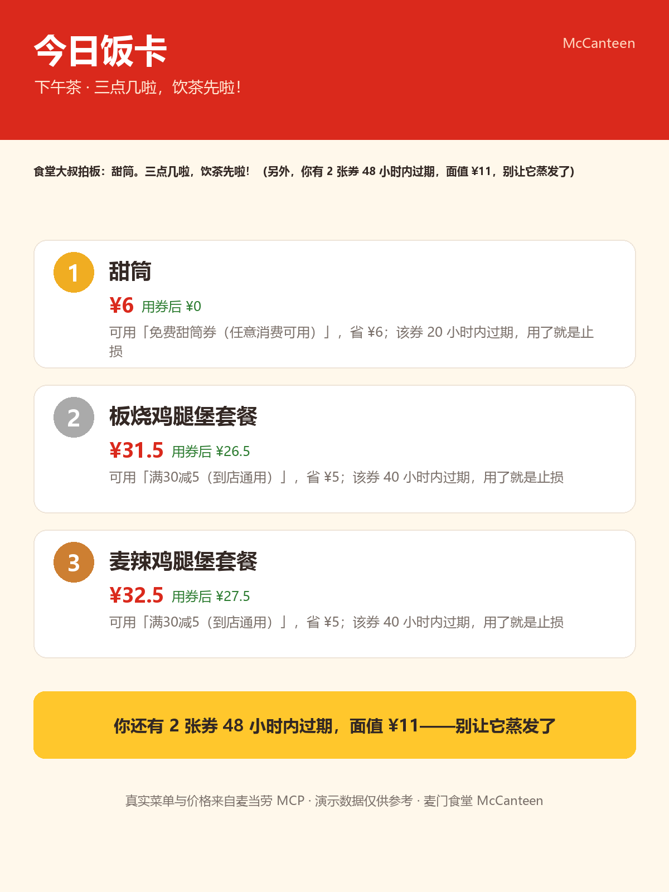
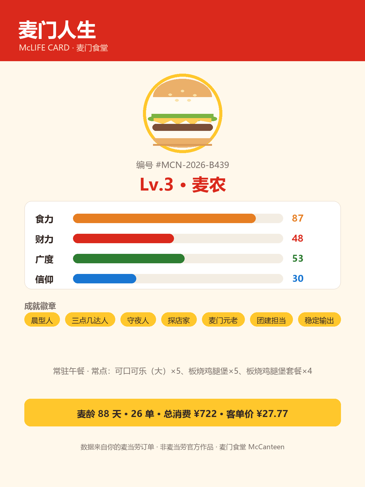
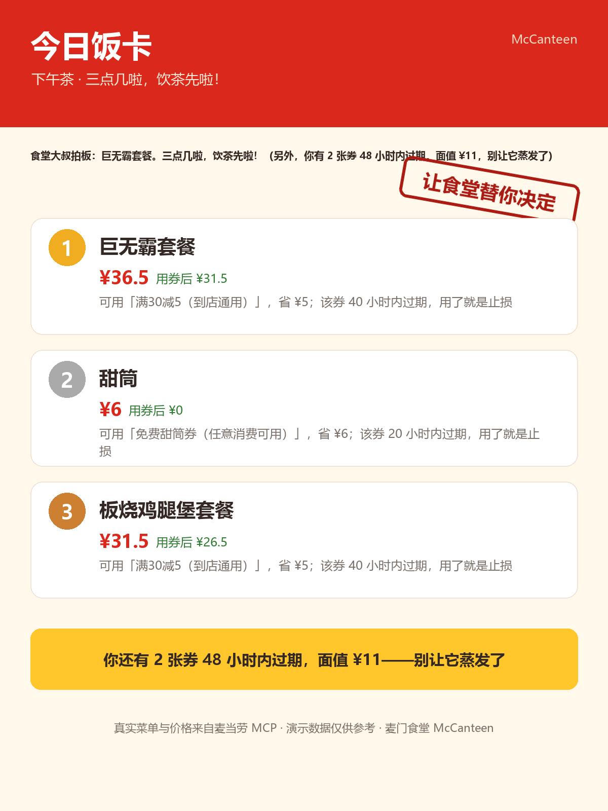

# 麦门食堂 McCanteen

> **今天吃什么？别问群聊了，问食堂。**


麦门食堂是一个 **WorkBuddy Skill**：基于麦当劳中国官方 MCP 的真实菜单、价格、门店与优惠券，
专治打工人的每日终极之问——**「今天吃什么」**。

它不是又一个随机抽奖器，也不是又一个省钱计算器。它做三件事：

| | 能力 | 回答的问题 |
|---|---|---|
| 🍱 | **决断引擎** | 现在、这个预算、这个处境，点什么？（3 秒拍板） |
| ⏳ | **止损雷达** | 我正在白扔多少钱？（券和积分，是有保质期的钱） |
| 🎴 | **麦门人生** | 我这一年到底怎么吃的？（RPG 档案 + 可分享角色卡） |

**食堂立场：别的 Skill 帮你「花得更省」，我们帮你「决定得更快、损失得更少」。**

* * *

## 它解决的，是三个真实的痛

1. **群聊问「今天吃什么」，平均 47 分钟没人拍板。** 选择困难是当代打工人最大的隐性内耗。
2. **你的券包正在缩水，却从来没人告诉你。** 一张 40 小时后过期的满减券，就是正在蒸发的钱——人对损失的敏感度是对收益的两倍，而这个数字一直没人替你算。
3. **吃了一年麦当劳，却说不出自己怎么吃的。** 订单数据躺在那里，从未变成任何有意思的东西。

## 项目演示

完整链路：**提问 → 真实菜单 → 券加权 → 拍板 → 饭卡 →（你确认后）下单**。



<details>
<summary>命令行实录（下午茶 · 演示数据）</summary>

```
$ python scripts/mcd_decide.py --slot tea --context "下午摸鱼，想喝点什么"

🍱 下午茶 · 三点几啦，饮茶先啦！
食堂大叔拍板：甜筒。三点几啦，饮茶先啦！（另外，你有 2 张券 48 小时内过期，面值 ¥11，别让它蒸发了）

① 甜筒  ¥6
   可用「免费甜筒券（任意消费可用）」→ 用券后 ¥0
   · 可用「免费甜筒券（任意消费可用）」，省 ¥6
   · 该券 20 小时内过期，用了就是止损

② 板烧鸡腿堡套餐  ¥31.5
   可用「满30减5（到店通用）」→ 用券后 ¥26.5
   · 该券 40 小时内过期，用了就是止损

③ 麦辣鸡腿堡套餐  ¥32.5
   可用「满30减5（到店通用）」→ 用券后 ¥27.5
```

</details>

**注意 ① 是怎么赢的**：不是因为甜筒多好吃，而是因为那张免费甜筒券 20 小时后过期——
优惠引导 + 损失厌恶，让食堂把「止损」融进了每一次决断。

* * *

## 三个能力，展开说

### 🍱 决断引擎：3 秒拍板

- **处境理解**：「加班好累」→ 热量管饱的抚慰；「健完身」→ 低卡高蛋白；「想喝咖啡」→ 明确品类优先（+50，压过一切优惠引导）
- **时段感知**：早餐/午餐/下午茶/晚餐/夜宵各有台词——凌晨一点的建议和下午三点不应该一样
- **反重复**：7 天内吃过 −20 分，帮你走出「永远板烧鸡腿堡」的循环；从没点过 +5 分，轻度舒适区挑战
- **预算硬过滤**：预算内无解时自动放宽，并**如实说明**
- **券加权**：能用上的券 +25；48 小时内过期的再加 +15——用了就是止损

### ⏳ 止损雷达：券和积分，是有保质期的钱

```
$ python scripts/mcd_expiring.py

⏳ 止损雷达 —— 正在蒸发的钱，量化给你看

24 小时内（1 张 · 面值 ¥6.00）
  · 免费甜筒券（任意消费可用）  ¥6.00 · 20 小时后过期
48 小时内（+1 张 · 面值 ¥5.00）
  · 满30减5（到店通用）  ¥5.00 · 40 小时后过期
7 天内（+3 张 · 面值 ¥29.60）
长期有效：2 张

沉默成本：2 张券将在 48 小时内过期，面值合计 ¥11.00；另有 1200 积分将在 96 小时内过期。这是正在蒸发的钱，别让它蒸发了。
```

「券的沉默成本」会回流进决断引擎：临期券对应的餐品自动获得加权——
**每一次决断，顺手止损。**

### 🎴 麦门人生：把订单玩成 RPG



- 从 `order-list` 真实订单生成：麦龄、总消费、客单价、TOP 单品、时段画像
- RPG 映射：等级（麦芽 → 麦苗 → 麦农 → 麦场主 → 麦香居士 → 麦门长老 → **麦门之主**）、四属性（食力/财力/广度/信仰）、成就徽章（晨型人、三点几达人、守夜人、团建担当……）
- 一张 1200×1600 角色卡，**适合发朋友圈的那种**
- 摇一摇模式：`secrets` 真随机——「让食堂替你决定」，模型无权插手



* * *

## 我们做对了什么别人没做的

本届比赛已有 90+ 个项目，过半在做「省钱/推荐/随机」。我们的差异：

| 常见做法 | 麦门食堂 | 差别 |
|---|---|---|
| 随机抽个餐品了事 | 真随机只是模式之一；**真实菜单/价格/反重复**才是底座 | 抽奖器 vs 决策引擎 |
| 优化「这一单怎么点最省」 | 先解决「**决定本身**」：3 秒拍板，再顺手省钱 | 决断优先于优化 |
| 券 = 可用资源 | 券 = **有保质期的钱**：48h 沉默成本量化，临期加权回流决断 | 别处见不到这个联动 |
| 让模型估算价格 | 价格只来自 MCP `calculate-price` 回填，未核实标「价格未核实」 | 价格不编造 |
| 年度一次性报告 | RPG 角色卡 + 每日可玩的档案 | 一次性 vs 日常 |
| 上云 / API Key / 账号体系 | 纯本地运行，零账号，Token 只进环境变量 | 门槛与隐私 |
| 中文报告里混英文占位 | 全中文卡片，程序排版，中文价格编号不溢出 | 完成度 |

## 架构

```
                 ┌──────────────────────────────┐
                 │           SKILL.md           │  食堂大叔编排（触发/流程/铁律）
                 └──────────────┬───────────────┘
        ┌───────────────────────┼───────────────────────┐
        ▼                       ▼                       ▼
┌───────────────┐      ┌────────────────┐      ┌────────────────┐
│  decide.py    │      │  expiring.py   │      │   life.py      │
│  决断引擎      │      │  止损雷达       │      │  麦门人生      │
└───────┬───────┘      └───────┬────────┘      └───────┬────────┘
        │                      │                       │
        └──────────┬───────────┘───────────────────────┘
                   ▼
          ┌────────────────┐        ┌─────────────────┐
          │  models.py     │◄──────►│  mcp_client.py  │  live：官方 MCP
          │  分→元唯一入口  │        │  (JSON-RPC)     │
          └────────────────┘        └─────────────────┘
                   ▲                         │
                   │                fixtures.py（演示数据，零 Token 可跑）
                   ▼
          ┌────────────────┐
          │  cardgen.py    │  Pillow 程序排版：人生角色卡 / 今日饭卡
          └────────────────┘
```

三条链路共用一套数据底座；算法层不接触原始响应，单位换算只有 `models.fen_to_yuan()` 一个入口。

## 目录结构

```
McCanteen/
├── SKILL.md                      # Skill 编排主文档（触发/流程/工具规则/铁律）
├── README.md                     # 本文件
├── MCP_INTEGRATION.md            # MCP 集成说明与实测状态
├── CONTEST_DECLARATION.md        # 参赛声明（官方原件，未改动）
├── mcp-config.example.json       # 脱敏 MCP 配置（仅环境变量占位符）
├── workbuddy.md                  # WorkBuddy 开发对话上下文
├── LICENSE
├── src/mccanteen/                # 核心包（纯标准库）
│   ├── models.py                 # 数据模型 + 分→元唯一换算入口
│   ├── timeslots.py              # 五时段判断（含跨午夜夜宵档）
│   ├── fixtures.py               # 演示数据加载（离线可跑）
│   ├── mcp_client.py             # 麦当劳 MCP 客户端（Streamable HTTP / JSON-RPC）
│   ├── decide.py                 # 决断引擎（打分/券加权/反重复/摇一摇）
│   ├── shake.py                  # secrets 真随机
│   ├── expiring.py               # 止损雷达（分桶/沉默成本）
│   ├── life.py                   # 麦门人生 RPG 档案
│   └── cardgen.py                # 卡片排版（Pillow）
├── scripts/                      # CLI（--live 切真实 MCP）
│   ├── mcd_decide.py / mcd_shake.py / mcd_expiring.py / mcd_life.py
├── references/                   # decide-rules / mcp-contracts / card-design
├── fixtures/                     # 演示数据（24 餐品 / 7 券 / 26 订单）
├── tests/                        # 零依赖测试，6 个文件 101 项断言
└── examples/                     # 示例卡片与演示实录
```

## 安装与使用

### 1. 获取代码

```bash
git clone https://github.com/<your-name>/McCanteen.git
cd McCanteen
pip install Pillow        # 唯一第三方依赖，且仅出卡需要
```

### 2. 安装为 WorkBuddy Skill（二选一）

```bash
# 用户级：对本机所有项目生效
cp -r McCanteen ~/.workbuddy/skills/McCanteen

# 项目级：仅当前工作区
cp -r McCanteen {workspace}/.workbuddy/skills/McCanteen
```

### 3. 配置麦当劳中国 MCP（可选，不上线也能玩）

在 WorkBuddy【连接器】→【自定义连接器】→【配置 MCP】填入
`mcp-config.example.json` 的内容，并把 `YOUR_MCP_TOKEN` 换成你在
[open.mcd.cn/mcp](https://open.mcd.cn/mcp) 申请的 Token。

> 没有 Token？全部能力基于 fixtures 演示数据运行，输出会明确标注「演示数据」。

### 4. 跑起来

```bash
python scripts/mcd_decide.py --context "加班到九点好累" --budget 30
python scripts/mcd_shake.py                       # 选择困难症发作时
python scripts/mcd_expiring.py                    # 看看正在蒸发的钱
python scripts/mcd_life.py --card my-mclife.png   # 生成你的角色卡

# 真实数据冒烟（需 MCD_MCP_TOKEN 环境变量）
python scripts/mcd_decide.py --live
```

### 5. 在对话中触发

装了 Skill 之后，直接对 WorkBuddy 说：

- 「今天吃什么」「不知道点啥，预算 25」
- 「摇一摇，替我决定」
- 「我的麦当劳券快过期吗？」
- 「生成我的麦门人生角色卡」

## 测试

```bash
python tests/run_all.py
```

| 测试文件 | 断言数 | 覆盖 |
|---|---:|---|
| `test_models.py` | 16 | 分/元换算、四种券型适用性、订单热量 |
| `test_timeslots.py` | 18 | 五时段 15 个边界值 |
| `test_decide.py` | 20 | 沉默成本识别、券加权、过期加急、反重复、处境匹配、摇一摇确定性 |
| `test_expiring.py` | 12 | 分桶、沉默成本、结论文案、空态 |
| `test_life.py` | 27 | 统计口径、等级台阶、属性、成就、空档案 |
| `test_cardgen.py` | 8 | 真实渲染 PNG、尺寸、像素校验、降级分支 |

**当前结果：101 / 101 全部通过**（Python 3.13 实测；零网络依赖，卡片测试在临时目录产出真实 PNG）。

## 能力现状：已验证 / 未验证 / 已知限制

### ✅ 已验证

- 全部引擎逻辑（打分/分桶/RPG 映射）与 101 项断言；
- 两张卡片真实渲染（1200×1600，像素级校验）；
- 降级路径：无 Token → fixtures 演示；预算内无解 → 放宽并说明；餐品视觉缺失 → 不静默失败。

### ⚠️ 未验证 / 规划中

- **live MCP 数据解析适配**：客户端协议已实现，但 `query-my-coupons` 等接口可能返回 Markdown 文本，字段映射需按真实返回校准（见 `references/mcp-contracts.md`）；
- **`create-order` 下单闭环**：规划中。上线前必须实现「明确确认才下单」铁律——创建订单 ≠ 支付成功；
- `campaign-calendar` 活动节奏建议：规划中。

### 已知限制

- 演示数据（fixtures）为结构镜像，**不是实时价格**；真实价格以门店实时查询为准；
- 积分与人民币的换算关系未经官方确认，止损雷达只报积分不折算金额。

## 安全、隐私与免责

- **下单铁律**：未获用户明确「确认下单」，绝不调用 `create-order`；商品/门店/价格任一变化，确认即失效。
- 不编造餐品、价格、优惠、库存；未核实价格一律标注，不用演示价冒充实时价。
- 不收集、不存储用户隐私；仓库不含 Token、Cookie、订单号；Token 只从环境变量读取。
- 本项目为麦当劳程序员创意开发大赛参赛作品，**非麦当劳官方产品**；商标与商品图归其权利人所有，仅通过官方 MCP 接口调用服务。
- 营养信息仅供参考，不构成医疗或营养建议。

## 参赛文件清单（依据官方赛事要求）

| 文件 | 说明 | 状态 |
|---|---|---|
| `README.md` | 项目介绍、安装方法、使用示例、目标用户 | ✅ 本文件 |
| `CONTEST_DECLARATION.md` | 参赛声明（官方原件，文件名与内容均未改动） | ✅ 已提供 |
| `MCP_INTEGRATION.md` | 实际使用的 MCP Server / Tool / 调用流程 / 业务价值 | ✅ 已提供 |
| `mcp-config.example.json` | 脱敏后的 MCP 配置示例（仅环境变量占位符） | ✅ 已提供 |
| 源代码 | 项目主体 | ✅ `src/` + `scripts/` |
| `workbuddy.md` | WorkBuddy 开发对话上下文 | ✅ 已提供 |

## 许可证

MIT，见 [LICENSE](LICENSE)。

> 如果这个食堂对你的胃口，一个 star 就是最好的反馈。⭐
